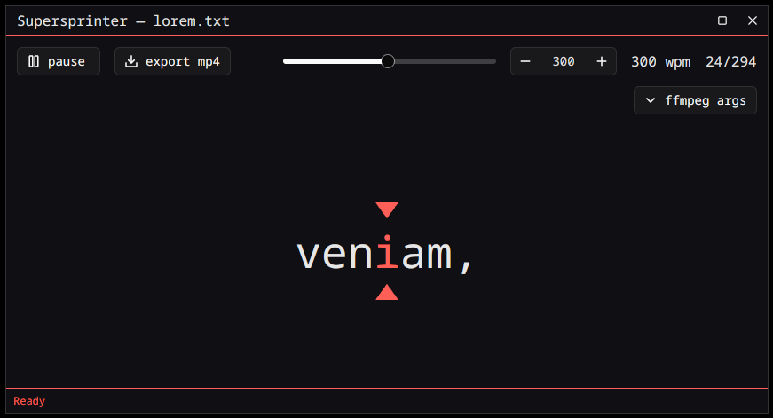
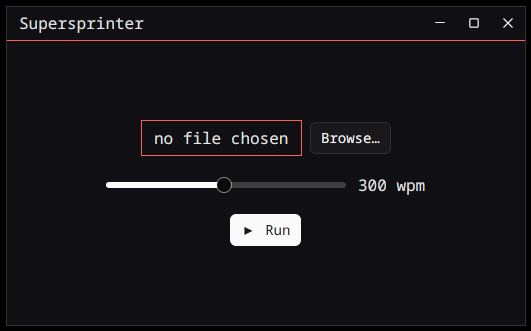
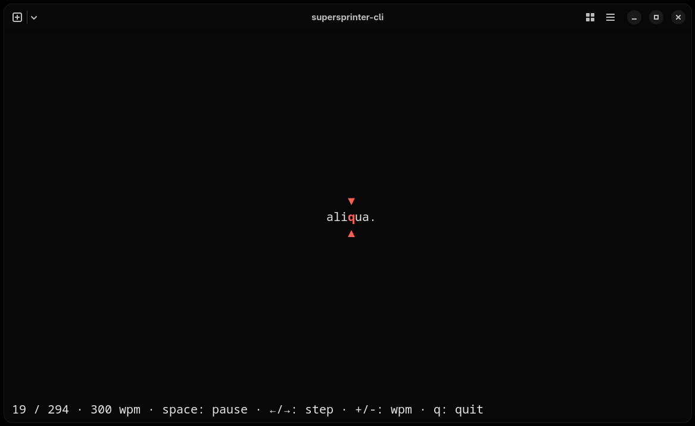

# Supersprinter

RSVP (rapid serial visual presentation) speed reader. Reads a plain-text book
and presents one word at a time with a fixed pivot (ORP) letter, so the eye
never has to move. Ships a terminal reader, a graphical (gpui) reader and an
MP4 renderer.



| GUI launcher | Terminal reader |
|:---:|:---:|
|  |  |

The screenshots above show a lorem ipsum sample text.

## Crates

| Crate | What it is |
|---|---|
| `crates/core` | No-UI logic: book loading (`load_book`), frame generation (`frames` — a lazy, allocation-free view over the text: pivot at ~30% of the word, Glance-style pacing: extra ticks after sentence ends, commas, long words; `first_pos`/`frame_at`/`next_pos`/`seek_pos` give readers a seekable cursor without materializing the stream), theme loading from TOML. |
| `crates/render` | Renders each frame to an RGBA image (ab_glyph + image, batches drawn in parallel with rayon) and encodes 1280×720/24fps MP4 via libx264 by default (ffmpeg-next). |
| `crates/cli` | `supersprinter-cli`: ratatui terminal reader (`supersprinter-cli book.txt 300`) plus `supersprinter-cli render book.txt [out.mp4] [wpm]`. |
| `crates/gui` | `supersprinter-gui`: gpui desktop app. Launcher window (file picker, WPM slider, Run) and reader window (canvas-rendered word with ▼/▲ pivot markers, play/pause, slider + numeric WPM input, progress). Client-side window decorations with working close/minimize/fullscreen and edge resize. |

## Theme

`theme.toml` with `background`, `text`, `arrows` as `#rrggbb`, optional
`pivot` (`#rrggbb`, defaults to `text`) and optional `font` (font family
name, default `monospace`; applied by the GUI and MP4 renderer — the CLI
uses the terminal font). Search order: `./theme.toml`,
`~/.config/supersprinter/theme.toml`, `~/.supersprinter/theme.toml`. With
no file found, the default theme embedded at build time
(`themes/default.toml`) is used. An invalid file is a hard error.

## Building

Requires a Rust stable toolchain (edition 2024). The `render`/`gui` crates
need system libraries: ffmpeg development headers (libavcodec etc.) and, for
`gui`, GPUI's Linux deps (libxkbcommon, wayland, fontconfig, etc. — see the
[gpui README](https://github.com/zed-industries/zed)).

```sh
cargo build --workspace

# terminal reader
cargo run -p supersprinter-cli -- book.txt 300
# render an mp4
cargo run -p supersprinter-cli -- render book.txt out.mp4 300
# GUI: launcher window, or open a book directly
cargo run -p supersprinter-gui
cargo run -p supersprinter-gui -- book.txt 300
```

## Releases & packaging

Prebuilt artifacts are published on the
[GitHub releases page](https://github.com/piotreknow02/supersprinter/releases)
(checksums in `supersprinter-v<X>-checksums.sha256` / `.md5`). All artifacts
are **unsigned**: Windows SmartScreen and macOS Gatekeeper will warn on first
launch (on macOS: right-click → Open once).

| Platform | Artifacts | ffmpeg (video export) |
|---|---|---|
| Linux x86_64 / aarch64 | `.deb`, `.rpm`, `.AppImage`, `.tar.gz` | deb/rpm: distro libav* pulled automatically; AppImage: bundled inside |
| Windows x64 / arm64 | `.msi`, portable `.zip` | bundled (DLLs ship next to the exe) |
| macOS arm64 / x86_64 | `.dmg` | system dependency: `brew install ffmpeg` |

The `.tar.gz` unpacks at `/` (FHS layout: `usr/bin/supersprinter`, desktop
entry, hicolor icons, license). For a per-user dev install from a checkout:

```sh
scripts/install-linux.sh            # --release by default; --debug, --prefix, --no-build exist too
scripts/uninstall-linux.sh
```

Packaging scripts (all run from a checkout; they self-verify the produced
packages):

```sh
cargo build --release --bin supersprinter-gui
scripts/package-linux.sh stage     --version 0.1.0   # FHS payload in dist/stage
scripts/package-linux.sh tarball   --version 0.1.0
scripts/package-linux.sh deb       --version 0.1.0   # needs dpkg-dev
scripts/package-linux.sh rpm       --version 0.1.0   # needs rpm-build
scripts/package-linux.sh appimage  --version 0.1.0   # downloads pinned appimagetool
scripts/package-macos.sh --version 0.1.0             # macOS only (hdiutil)
```

Icons are generated from `assets/icon.svg` and committed — run
`scripts/gen-icons.sh` after changing the icon (needs `rsvg-convert` +
`icotool`, or python3-gobject + python3 as fallback).

Releases are cut from `main` via the **Release (Manual Main Only)** workflow:
it validates the input version against `[workspace.package] version`, tags,
builds all six platform artifacts and attaches them with checksums to the
GitHub release.

## Encoder choice

`--ffmpeg-args` (CLI `-f`, GUI "ffmpeg args" field) passes `-key value`
options to the encoder and muxer. `-c:v`/`-codec:v`/`-vcodec` additionally
selects the encoder; the built-in default is the portable software encoder
libx264 with `-preset veryfast -tune stillimage -crf 20` — tuned for
flat-background text and already using every CPU core. Output is always
muxed with `-movflags +faststart`.

Recommended configs (pass with `-f "..."`):

| Config | ffmpeg-args | Notes |
|---|---|---|
| Default (built-in) | *(no args needed)* | libx264 `-preset veryfast -tune stillimage -crf 20`; ~3–4× faster than `medium` with no visible loss on text. Use `-preset medium -crf 18` if you want a smaller archive file |
| NVIDIA | `-c:v h264_nvenc -preset p5 -rc vbr -cq 24 -b:v 0 -profile:v high` | Offloads encoding to the NVENC chip, CPU stays free for drawing; `-profile:v high` matters because NVENC defaults to `main`; raise `-cq` (28) for speed, lower (20) for quality |
| AMD | `-c:v h264_amf -quality speed -rc_mode cqp -qp_i 20 -qp_p 22` | AMF hardware encoder; `speed` is the fastest mode ffmpeg exposes (the SDK's `turbo` is not mapped) and static text hides its quality cost — use `balanced` if edges look soft; Linux needs the AMF runtime (`libamfrt64.so.1`) |
| Intel | `-c:v h264_qsv -global_quality 23` | Quick Sync on iGPU (or Arc dGPU); lower `-global_quality` = better; needs the oneVPL runtime |
| Apple | `-c:v h264_videotoolbox -realtime 0 -q:v 65` | VideoToolbox hardware encoder on Apple Silicon/Intel Macs; `-realtime 0` allows full-quality non-live encode; `-q:v` 1–100 |

The built-in default was verified sharp (no blur/ringing on text edges).
If your machine is too slow and you want to trade quality for speed
anyway: raise `-crf` (23–28), drop the preset
(`-preset fast`/`faster`/`ultrafast`), or go extreme with
`-x264-params subme=2:me=dia:rc-lookahead=0`. Hardware equivalents:
NVENC `-preset p1` with `-cq 30`, AMF `-quality speed` (already the
default above), QSV `-global_quality 28`, VideoToolbox `-q:v 50`.

Hardware encoders are ~10–20% larger than x264 at visually equal quality —
use them to free the CPU, not to shrink files. `h264_vaapi` is not
reachable this way: it needs a hwframe context the `-key value` format
cannot express.

## Usage

Both readers show one word at a time with the pivot (ORP) letter highlighted
and marked by ▼/▲. The `wpm` argument is the base speed; pacing on top of it
is automatic — sentence ends, commas and long words get extra time. Both
readers follow the [theme](#theme).

### Terminal reader

```sh
supersprinter-cli book.txt 300
```

| Key | Action |
|---|---|
| <kbd>space</kbd> | play / pause |
| <kbd>←</kbd> / <kbd>→</kbd> | step one word back / forward |
| <kbd>+</kbd> / <kbd>-</kbd> | speed ±25 wpm (20–1200) |
| <kbd>q</kbd> / <kbd>Esc</kbd> | quit |

The status line shows progress (`word / total`), the current speed and the
key hints. Reaching the last word exits with status 0.

### Desktop app

The launcher picks a `.txt` file (<kbd>Browse…</kbd>) and a starting speed
(slider, 10–600 wpm); <kbd>Enter</kbd> runs, <kbd>Esc</kbd> closes. The
reader window adds:

- **play/pause** and **export mp4** buttons — export asks for a destination
  and encodes in the background, progress and result land in the status bar
- a WPM slider (10–600) *and* a free numeric input (1–4000), kept in sync
- word progress (`24/294`) and a status bar (`Ready`, export messages)
- an **ffmpeg args** collapsible accepting the same options as the CLI `-f`
  (see [Encoder choice](#encoder-choice))
- the same keys as the CLI: <kbd>space</kbd>, <kbd>←</kbd>/<kbd>→</kbd>,
  <kbd>+</kbd>/<kbd>-</kbd>, <kbd>q</kbd>/<kbd>Esc</kbd> (typing in an input
  box never drives the reader)

### MP4 rendering

```sh
supersprinter-cli render book.txt                          # -> book.mp4
supersprinter-cli render book.txt out.mp4 400
supersprinter-cli render book.txt out.mp4 300 -f "-c:v h264_nvenc -preset p5"
```

Output is 1280×720 at 24 fps, always muxed with `-movflags +faststart`;
`-f`/`--ffmpeg-args` passes any encoder/muxer options
([Encoder choice](#encoder-choice)). The GUI's **export mp4** button does
the same from a save dialog at the speed currently shown in the reader.

## Credits

- [Glance](https://github.com/Miserlou/Glance), whose RSVP pacing ideas this reader borrows from
- [GitComet](https://github.com/Auto-Explore/GitComet), the model for the Rust desktop CI/CD and release pipeline
